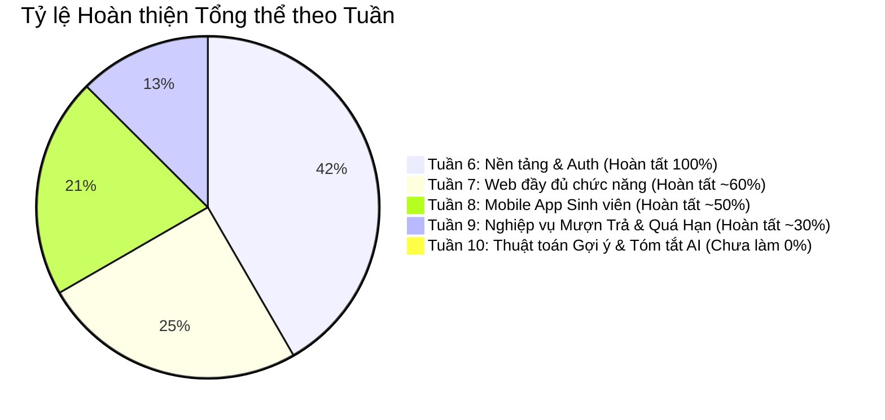
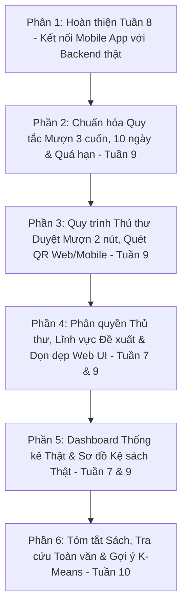

# BẢNG ĐÁNH GIÁ TIẾN ĐỘ THỰC TẾ CHI TIẾT (TỪ TUẦN 6 ĐẾN TUẦN 10)
> **Dự án:** Khóa luận tốt nghiệp - Hệ thống Quản lý Thư viện HUIT  
> **Tài liệu căn cứ:** Đề cương chi tiết `CNTT-KLCN119.docx` & Quy định thực tế `Quy định thư viện.docx`  
> **Nguyên tắc:** Đánh giá trung thực, minh bạch 100% dựa trên toàn bộ mã nguồn hiện tại của Backend, Web App và Mobile App. Chỉ rõ phần nào đã làm thật, phần nào còn dùng Dữ liệu giả (Mock), phần nào chưa làm.

---

## TỔNG QUAN TIẾN ĐỘ THEO CÁC TUẦN

---

## I. CHI TIẾT TIẾN ĐỘ TỪNG TUẦN

### 🟢 TUẦN 6: Cài đặt Chức năng Nền tảng, Auth & Quản lý Danh mục
*Đánh giá tiến độ: **100% (Hoàn thành trọn vẹn)** ✨*

| Hạng mục theo Đề cương | Hiện trạng trong Code | Trạng thái | Đánh giá chi tiết |
|:---|:---|:---:|:---|
| **1. Đăng nhập / Đăng xuất / Đổi mật khẩu** | JWT Access Token, Refresh Token, Blacklist Redis. API `/login` trả về đầy đủ hồ sơ người dùng (`userId`, `fullName`, `email`, `mssv`, `role`, `isFirstLogin`, `avatarUrl`, `cardStatus`). | ✅ 100% Hoàn thành | Đã tối ưu hóa lưu trữ cache trên cả Web và Mobile App, không cần gọi thêm request phụ. |
| **2. Quên mật khẩu / Gửi OTP email** | API `/forgot-password`, `/verify-otp`, `/reset-password` hoạt động chuẩn. Chuẩn hóa đồng bộ key Redis giữa MSSV & Email. Dùng `SecureRandom` 6 số (100000-999999). | ✅ 100% Hoàn thành | Hết hạn sau 10 phút, tự hủy OTP ngay sau khi đổi mật khẩu để chống Replay Attack. |
| **3. API Danh mục Sách (CRUD)** | `BookController.java` & `BookService.java` đầy đủ CRUD, phân trang, lọc theo thể loại (`categoryId`), cập nhật toàn diện tác giả, NXB, bìa sách. | ✅ 100% Hoàn thành | Đã kết nối cơ sở dữ liệu thật và Elasticsearch. |
| **4. Database Schema (PostgreSQL, Mongo, Redis, ES)** | Liquibase chạy ổn định (12 changesets), Docker Compose đủ 7 dịch vụ. | ✅ 100% Hoàn thành | Khởi động mượt mà, cấu hình bảo mật Spring Security & CORS chuẩn. |

---

### 🟡 TUẦN 7: Phát triển Phân hệ Web Đầy Đủ Chức Năng
*Đánh giá tiến độ: **~60% (Nhiều màn hình Web Admin đang dùng dữ liệu Mock cứng)***

| Hạng mục theo Đề cương | Hiện trạng trên Web Admin / Portal | Trạng thái | Điểm còn thiếu / Còn Mock |
|:---|:---|:---:|:---|
| **1. Quản lý Sách (`admin/books`)** | Đã nối API thật: xem danh sách, phân trang, mở Drawer thêm/sửa sách. | ✅ Hoàn thành | Hoạt động tốt. |
| **2. Quản lý Sinh viên (`admin/accounts`)** | Đã có danh sách sinh viên gọi từ API Backend. | ⚠️ Thiếu phân quyền | - **Chưa phân quyền Role Thủ thư:** Thủ thư vào trang này vẫn thấy giao diện như Admin. Cần ẩn nút thêm/sửa/xóa với Thủ thư (chỉ cho xem). - Modal Import Excel sinh viên mới là UI tĩnh. |
| **3. Quản lý Nhập sách (`admin/imports`)** | Web có giao diện lập phiếu nhập và nhà cung cấp. | ❌ Chưa nối thật | **Lệch URL API:** Web gọi `/imports/receipts` nhưng Backend viết là `/inventory/receipts` -> Chưa lưu được phiếu nhập vào DB thật. |
| **4. Quản lý Vị trí sách (`admin/shelf-map`)** | Có giao diện bản đồ sơ đồ kệ sách tầng 3. | ❌ Mock 100% | File `shelf-map.ts` hoàn toàn rỗng. Tọa độ kệ `IT-204` đang fix cứng HTML tĩnh, chưa load dữ liệu tầng/kệ từ bảng `floors`, `bookshelves`, `shelves`. |
| **5. Quản lý Mượn trả (`admin/borrows`)** | Có giao diện dashboard mượn trả và nợ phạt. | ❌ Mock 100% | Các số liệu (28.450 sinh viên, 4.120 đang mượn, 86 ca quá hạn) và bảng danh sách bạn đọc quá hạn là **HTML tĩnh 100%**. |
| **6. Quầy Lưu thông Mượn trả (`admin/circulation`)** | Có ô nhập MSSV và barcode sách. | ⚠️ Chưa hoàn thiện | - Chưa có Modal duyệt phiếu mượn (Lập phiếu / Từ chối) khi bạn đọc đưa mã QR đặt trước. - Chưa có kiểm tra điều kiện thẻ sinh viên trước khi cho mượn. |
| **7. Quản lý Đề xuất sách (`admin/suggestions`)** | Đã nối API `getAllProposalsForAdmin()`, duyệt/từ chối được. | ⚠️ Thiếu trường | Đang thiếu cột **Lĩnh vực / Thể loại sách** (`categoryName`). |
| **8. Quản lý Tài liệu số (`admin/digital-assets`)** | Web có giao diện kéo thả upload tài liệu PDF. | ❌ Chưa có Backend | Backend chưa có `DigitalAssetController`, chưa có API upload lưu trữ file PDF. |
| **9. Kiểm kê sách (Inventory Audit)** | Backend có API stub `/inventory/audits`. | ❌ Chưa làm | Web Admin chưa có trang thực hiện quét mã vạch kiểm kê kho sách. |
| **10. Báo cáo & Thống kê (`admin/dashboard`)** | Web Admin có trang Dashboard. | ❌ Mock 100% | Toàn bộ số liệu Dashboard là giả do Backend **chưa có `DashboardController.java`**. |
| **11. Dọn dẹp Web UI** | Một số nút trên Admin & Portal chỉ là nút giao diện rác. | ❌ Cần rà soát | Cần xóa bỏ các nút mock thừa thãi không chức năng. |

---

### 🟠 TUẦN 8: Phát triển Mobile App (Dành cho Sinh viên)
*Đánh giá tiến độ: **~50% (Giao diện rất đẹp nhưng đang dùng Dữ liệu Mock ở các chức năng cốt lõi)***

| Hạng mục theo Đề cương | Hiện trạng trong Mobile App (`mobile-app/lib`) | Trạng thái | Điểm còn thiếu / Còn Mock |
|:---|:---|:---:|:---|
| **1. Đăng nhập / Đổi mật khẩu** | `login_screen.dart`, `change_password_screen.dart` | ✅ Hoàn thành | Đã nối API AuthService, lưu token SharedPreferences. |
| **2. Tra cứu sách (`search_screen.dart`)** | Tìm kiếm từ khóa, phân trang cuộn, lọc danh mục. | ✅ Hoàn thành | Đã gọi API `/books` của Backend. |
| **3. Xem chi tiết sách (`detail_screen.dart`)** | Xem bìa, tên, tác giả, năm xuất bản, nút Mượn sách. | ⚠️ Thiếu vị trí thật | Vị trí sách chưa liên kết động với tầng/kệ trong cơ sở dữ liệu. |
| **4. Xem sách đang mượn (`borrowed_screen.dart`)** | Hiển thị tiến độ mượn, số ngày còn lại. | ❌ Mock 100% | File `loan_service.dart` đang fix cứng 2 cuốn sách mẫu (`Cấu trúc dữ liệu` & `Kỹ nghệ phần mềm`) và lưu vào bộ nhớ máy, **hoàn toàn chưa kết nối API Backend `/circulation/my-loans`**! |
| **5. Nhận thông báo nhắc hạn (`notifications_screen.dart`)** | Danh sách thông báo quá hạn, sắp đến hạn. | ❌ Mock 100% | 3 thông báo mẫu (Clean Architecture, Flutter in Action, DDD) là **chữ fix cứng trong code UI**, chưa có API lấy thông báo thật từ server. |
| **6. Xem kết quả sách gợi ý (`home_screen.dart`)** | Danh sách ngang "GỢI Ý CHO BẠN" ở trang chủ. | ❌ Mock 100% | 3 cuốn sách (Domain-Driven Design, Head First Design Patterns, Clean Code) được code cứng vào ListView, chưa có API gợi ý. |
| **7. Gửi đề xuất mua sách mới (`suggest_book_screen.dart`)** | Form nhập tên sách, tác giả, lý do. | ⚠️ Lệch API & Thiếu | - Gọi sai URL (`/feedback/proposals` thay vì `/proposals`). - Đang thiếu trường chọn **Lĩnh vực** sách. |
| **8. Quét mã QR duyệt sách cho Thủ thư** | Dành cho vai trò Thủ thư khi cầm điện thoại tại quầy. | ❌ Chưa làm | Mobile app chưa tích hợp Camera quét mã QR phiếu mượn. |

---

### 🔴 TUẦN 9: Hoàn thiện Nghiệp vụ Mượn - Trả, Quá hạn & Phân quyền Thủ thư
*Đánh giá tiến độ: **~30% (Mới chỉ có khung sườn cơ bản, các ràng buộc quy định chưa được áp dụng)***

| Hạng mục theo Đề cương & Quy định | Hiện trạng Codebase | Trạng thái | Việc cần làm |
|:---|:---|:---:|:---|
| **1. Ràng buộc tối đa 3 cuốn sách** | Chưa kiểm tra, cho mượn vô hạn. | ❌ Chưa làm | Backend + Mobile: chặn nếu đang giữ $\ge 3$ cuốn. |
| **2. Thời hạn mượn 10 ngày (Quy định)** | Đang cộng cứng **14 ngày**. | ⚠️ Sai lệch | Sửa thành **10 ngày** ở Backend và Mobile. |
| **3. Gia hạn 10 ngày & Chặn khi quá hạn** | Đang cộng 7 ngày; quá hạn vẫn cho gia hạn tiếp. | ⚠️ Sai lệch | Gia hạn 10 ngày; nếu `dueDate < now()` bắt buộc ra quầy. |
| **4. Chặn mượn mới nếu có nợ / quá hạn** | Chưa kiểm tra sách quá hạn. | ❌ Chưa làm | Chặn đặt mượn mới nếu có bất kỳ cuốn nào quá hạn chưa trả. |
| **5. Tự động hủy phiếu đặt giữ sau 4 ngày (Test)** | Chưa có tiến trình tự động (Scheduler). | ❌ Chưa làm | Viết Cron Job định kỳ 5 phút: Quét phiếu `PENDING` quá 4 ngày -> Hủy và trả bản sao về `AVAILABLE`. |
| **6. Modal Duyệt Mượn sách cho Thủ thư (2 nút)** | Chưa có modal duyệt chuẩn tại quầy. | ❌ Chưa làm | Modal gồm thông tin sách + bạn đọc; 2 nút: **"Lập phiếu mượn"** (BORROWING) và **"Từ chối"** (REJECTED). Hỗ trợ mở thẳng khi quét QR. |
| **7. Quét mã QR trên Mobile cho Thủ thư** | Chưa có màn hình quét QR camera. | ❌ Chưa làm | Thêm chức năng camera quét mã QR phiếu mượn trên Mobile App. |
| **8. Phân quyền Thủ thư trang Quản lý User** | Thủ thư vào trang User vẫn thấy nút xóa/sửa. | ❌ Chưa làm | Phân quyền: Thủ thư **CHỈ ĐƯỢC XEM**; chặn quyền Thêm/Sửa/Xóa. |
| **9. Tính tiền phạt trễ hạn tự động** | Controller rỗng (stub). | ❌ Chưa làm | Tự động tính tiền phạt `1.000đ/ngày` khi hoàn trả sách. |
| **10. Bổ sung trường Lĩnh vực cho Đề xuất sách** | DTO và Entity thiếu category. | ❌ Chưa làm | Thêm `categoryName` vào Backend, Web Portal, Web Admin và Mobile App. |

---

### ⚪ TUẦN 10: AI / Thuật toán Gợi ý Sách & Tra cứu Toàn văn
*Đánh giá tiến độ: **0% (Chưa bắt đầu)***

| Hạng mục theo Đề cương | Hiện trạng Codebase | Trạng thái | Việc cần làm |
|:---|:---|:---:|:---|
| **1. Tóm tắt nội dung sách (`summary`)** | Cột `summary` chưa có trong bảng `books`. | ❌ Chưa làm | Bổ sung trường `summary` (TEXT) vào PostgreSQL và Elasticsearch. |
| **2. Tra cứu toàn văn theo Tóm tắt sách** | Elasticsearch hiện chỉ quét Title, Author. | ❌ Chưa làm | Nâng cấp Search API quét qua cả nội dung tóm tắt sách để tìm chính xác chủ đề. |
| **3. Thuật toán Gợi ý Sách tương đồng (K-Means)** | Gợi ý đang dùng 3 cuốn sách mock cứng. | ❌ Chưa làm | Xây dựng thuật toán tính độ tương đồng nội dung / K-Means để gợi ý top 4 sách liên quan. |
| **4. Đánh giá kết quả thuật toán gợi ý** | Chưa có số liệu đánh giá. | ❌ Chưa làm | Đưa ra tiêu chí đánh giá độ chính xác (Precision/Recall hoặc độ tương đồng chuyên ngành). |

---

## II. DANH SÁCH TỔNG HỢP CÔNG VIỆC CẦN LÀM (CHIA THEO 5 PHẦN)

> [!IMPORTANT]
> **Cam kết:** Tôi **KHÔNG** tự ý sửa code lúc này. Danh sách này được thiết kế theo đúng thứ tự logic để khi bạn duyệt, chúng ta sẽ bắt tay làm dứt điểm từng phần!

### 📋 Phần 1: Xóa bỏ dữ liệu Mock ở Tuần 8 (Mobile App)
1. Kết nối `borrowed_screen.dart` trên Mobile với API Backend `GET /api/v1/circulation/my-loans` (thay thế 2 cuốn sách giả).
2. Xây dựng API thông báo thật ở Backend và kết nối vào `notifications_screen.dart` trên Mobile.
3. Sửa endpoint gửi đề xuất sách trong `suggest_book_screen.dart` về đúng URL `/proposals`.

### 📋 Phần 2: Chuẩn hóa Quy tắc Mượn - Trả theo Quy định Thư viện (Tuần 9)
1. Thêm validation chặn mượn quá 3 cuốn trên cả Backend và Mobile App.
2. Đổi thời hạn mượn về chuẩn **10 ngày** (thay vì 14 ngày).
3. Đổi thời gian gia hạn về **10 ngày**, chặn không cho gia hạn nếu sách đã quá hạn.
4. Chặn không cho mượn sách mới nếu tài khoản đang có sách quá hạn chưa trả.
5. Tạo Cron Job `@Scheduled` tự động hủy phiếu đặt giữ sau **4 ngày test** và nhả bản sao sách về `AVAILABLE`.

### 📋 Phần 3: Quy trình Thủ thư Duyệt Mượn Sách (Tuần 9)
1. Nâng cấp trang Quản lý phiếu mượn trên Web:
   - Khi bấm xem hoặc quét QR -> Hiện **Modal Chi tiết Phiếu Mượn** (Thông tin sách + Thông tin sinh viên).
   - Modal có 2 nút: **"Lập phiếu mượn"** (duyệt mượn thành công) và **"Từ chối"** (hủy phiếu).
   - Cung cấp luồng tạo phiếu mượn trực tiếp thủ công tại quầy.
2. Thêm tính năng **Quét mã QR bằng Camera trên Mobile App** dành riêng cho tài khoản Thủ thư để duyệt nhanh tại quầy.

### 📋 Phần 4: Phân quyền Thủ thư, Bổ sung Lĩnh vực & Dọn dẹp Web UI (Tuần 7 & 9)
1. Phân quyền trang Quản lý Người dùng: Thủ thư **CHỈ ĐƯỢC XEM**, ẩn toàn bộ nút Thêm/Sửa/Xóa/Import.
2. Thêm trường **Lĩnh vực** (`categoryName`) vào Đề xuất sách trên cả Backend, Web Portal, Web Admin và Mobile App.
3. Rà soát xóa các nút mock UI thừa thãi trên Web.

### 📋 Phần 5: Thống kê Dashboard Thật & Vị trí Sơ đồ Kệ Thật (Tuần 7 & 9)
1. Viết `DashboardController.java` truy vấn số liệu thật từ cơ sở dữ liệu PostgreSQL và nối vào Web Admin Dashboard.
2. Nối API quản lý nhập sách `/inventory/receipts` thay cho `/imports/...`.
3. Kết nối dữ liệu tầng/kệ thật vào màn hình Sơ đồ kệ sách (`admin/shelf-map`).

### 📋 Phần 6: Tóm tắt Sách, Tra cứu Toàn văn & Thuật toán Gợi ý (Tuần 10)
1. Thêm cột `summary` (tóm tắt) cho sách trong PostgreSQL và Elasticsearch.
2. Nâng cấp tìm kiếm tra cứu quét qua cả nội dung tóm tắt sách.
3. Triển khai thuật toán gợi ý sách tương đồng theo nội dung / K-Means và hiển thị trên Web + Mobile App.
