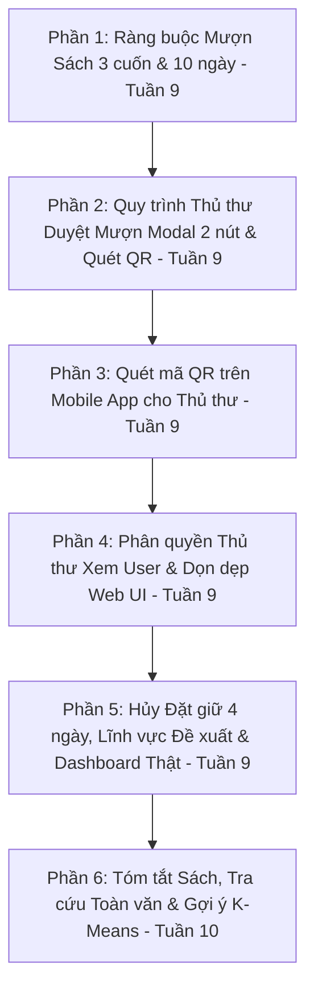

# KẾ HOẠCH TRIỂN KHAI HOÀN THIỆN ĐỒ ÁN THEO "QUY ĐỊNH THƯ VIỆN HUIT"
> **Tài liệu tham chiếu:** 
> - `Quy định thư viện.docx` (Trung tâm Thông tin - Thư viện Trường ĐH Công Thương TP.HCM)
> - `CNTT-KLCN119.docx` (Đề cương Khóa luận tốt nghiệp - Kế hoạch tiến độ tuần 1 đến tuần 12)  
> - Các yêu cầu nghiệp vụ bổ sung về **Thủ thư duyệt mượn (Modal/QR), Phân quyền Role Thủ thư, Tra cứu theo tóm tắt, Quét QR Mobile, Dọn dẹp Web UI**.
> 
> **Mục tiêu:** Đối chiếu toàn diện hiện trạng hệ thống, bổ sung chi tiết quy trình nghiệp vụ thực tế của Thủ thư và Sinh viên theo đúng tiến độ **Tuần 9 & Tuần 10**.

---

## 📌 MAPPING TIẾN ĐỘ ĐỒ ÁN (TUẦN 9 & TUẦN 10)

Theo Đề cương khóa luận [CNTT-KLCN119.docx](file:///e:/KhoaLuan/Docs/CNTT-KLCN119.txt#L131-L134):
- **Tuần 9:** *"Xây dựng nghiệp vụ: hoàn thiện mượn - trả - gia hạn, xử lý quá hạn, tính/ghi nhận tiền phạt, đồng bộ tình trạng sách và gửi thông báo nhắc hạn."*  
  👉 **Bao gồm Phần 1, Phần 2, Phần 3, Phần 4, Phần 5 và Phần 6 của kế hoạch này!**
- **Tuần 10:** *"Xây dựng nghiệp vụ: nghiên cứu, lựa chọn và triển khai thuật toán gợi ý sách dựa trên lịch sử mượn, chuyên ngành, thể loại quan tâm và nhu cầu học tập; đánh giá kết quả gợi ý."*  
  👉 **Bao gồm Phần 7 của kế hoạch này!**

---

## I. BẢNG ĐỐI CHIẾU HIỆN TRẠNG VỚI QUY ĐỊNH & YÊU CẦU MỚI

| STT | Quy định & Nghiệp vụ yêu cầu | Hiện trạng hệ thống (Codebase hiện tại) | Trạng thái | Hướng giải quyết chi tiết |
|:---:|:---|:---|:---:|:---|
| **1** | **Số lượng mượn tối đa:** Tối đa **3 tài liệu / bạn đọc**. Chỉ mượn sách nhãn trắng. Sách nhãn cam, xanh, Luận văn chỉ đọc tại chỗ (tối đa 2 tài liệu/lần). | Backend chưa kiểm tra số lượng sách đang mượn. Mobile dùng mock data cứng và lưu `SharedPreferences`, cho phép bấm mượn vô hạn. | ❌ Chưa làm | Thêm validation chặn nếu tổng số sách `(BORROWING + PENDING) >= 3` ở cả Backend và Mobile App. |
| **2** | **Thời hạn mượn:** Tối đa **10 ngày**. | Backend (`LoanService.java:119`) và Mobile (`loan_service.dart:67`) đang cộng cứng **14 ngày**. | ⚠️ Sai lệch | Chỉnh sửa `plusDays(14)` thành `plusDays(10)` ở Backend và Mobile App. |
| **3** | **Gia hạn tài liệu:** Được gia hạn thêm **10 ngày**. **Chỉ được gia hạn khi tài liệu CHƯA quá hạn** (sách quá hạn phải mang đến quầy). | Backend đang cộng **7 ngày** (`plusDays(7)`). Nếu sách đã quá hạn (`baseDate < now()`), Backend vẫn cho gia hạn thêm 7 ngày. | ⚠️ Sai lệch | Sửa thành `plusDays(10)`. Bổ sung kiểm tra: nếu `detail.dueDate < now()` thì ném ngoại lệ chặn gia hạn, yêu cầu mang sách đến thư viện. |
| **4** | **Ràng buộc khi mượn tiếp:** "Chỉ khi nào thanh toán xong các tài liệu mượn quá hạn, người sử dụng sẽ được mượn tiếp các tài liệu khác". | Backend chỉ kiểm tra `user.getDisciplineFlag()` hoặc `LOCKED`. Chưa kiểm tra người dùng có sách quá hạn chưa trả hay không. | ❌ Chưa làm | Trong hàm `reserveOrBorrowBook`, bổ sung truy vấn kiểm tra xem user có cuốn nào đang `OVERDUE` không, nếu có lập tức từ chối mượn mới. |
| **5** | **Thời gian giữ chỗ khi đặt trước (Test 4 ngày):** Quy định thư viện cho đặt trước; bạn yêu cầu **fix cứng 4 ngày để dễ test**. Quá hạn 4 ngày không đến nhận phải tự động nhả sách. | Hiện tại chỉ gán `lockedUntil = pickupDate + 2 ngày`, **hoàn toàn chưa có tiến trình tự động (Scheduler) nào quét để hủy và nhả bản in**. | ❌ Chưa làm | Viết `@Scheduled` chạy định kỳ 5 phút: Quét các phiếu `PENDING` có `createdAt/pickupDate` quá 4 ngày -> Chuyển thành `CANCELLED` và cập nhật `BookCopyEntity.status = 'AVAILABLE'`. |
| **6** | **Quy trình Thủ thư Duyệt mượn sách (2 cách):** • *Cách 1:* Bấm vào xem thông tin phiếu mượn HOẶC Quét QR -> Hiện Modal chi tiết (Thông tin sách + Thông tin người mượn) -> Bấm **"Lập phiếu mượn"** (chuyển sang `Success`/`BORROWING`) hoặc **"Từ chối"** (chuyển sang `Rejected`). • *Cách 2:* Mượn trực tiếp thủ công tại quầy (tự điền thông tin phiếu mượn, tra cứu tình trạng thẻ ở trang Quản lý người dùng). | Trang `admin/circulation` và `admin/borrows` đang chia rời rạc, chưa có modal duyệt phiếu mượn 2 nút ("Lập phiếu mượn" / "Từ chối") đồng bộ với mã QR từ bạn đọc. | ❌ Chưa làm | Nâng cấp trang Quản lý phiếu mượn: Viết Modal chi tiết phiếu mượn có 2 nút action duyệt/từ chối; kết nối API duyệt `approveTicket` / `rejectTicket`; hỗ trợ quét QR tự nhảy modal. |
| **7** | **Quét mã QR trên Mobile App cho Thủ thư:** Thủ thư đăng nhập app có thể quét QR phiếu mượn của sinh viên mang tới quầy để mở nhanh modal duyệt. | Mobile app hiện chỉ có các màn hình của sinh viên, chưa có màn hình Quét mã QR cho Thủ thư. | ❌ Chưa làm | Tích hợp thư viện quét mã QR (`mobile_scanner` / `qr_code_scanner`) trên Mobile App, kiểm tra nếu tài khoản là Thủ thư thì hiển thị nút quét QR duyệt mượn. |
| **8** | **Phân quyền chặt chẽ cho Thủ thư (Role LIBRARIAN):** Trang Quản lý người dùng: Thủ thư **CHỈ ĐƯỢC XEM** thông tin người dùng (để tra cứu tình trạng thẻ, tham gia lớp hướng dẫn chưa). **KHÔNG ĐƯỢC** cấp quyền Tạo, Thêm, Xóa, Sửa người dùng (chỉ Admin mới có). | Trang `admin/accounts` hiện tại chưa phân tách rõ ràng giao diện giữa Admin và Thủ thư; nút thêm/xóa/sửa chưa được ẩn/chặn theo Role. | ❌ Chưa làm | Phân quyền trang Quản lý người dùng: Ẩn các nút Thêm/Sửa/Xóa/Import với Thủ thư; Backend bảo vệ các API CUD user với `@PreAuthorize("hasRole('ADMIN')")`. |
| **9** | **Đề xuất sách bổ sung (Book Proposals):** Phải có thêm trường **Lĩnh vực / Thể loại sách** (`category` / `domain`). | `BookProposalEntity` và `CreateProposalRequestDTO` chỉ có `title, authorName, publisher, reason, note` (thiếu category). Web & Mobile chưa có ô nhập/chọn lĩnh vực. | ❌ Chưa làm | Thêm cột `category_name` vào bảng `book_proposals`, cập nhật DTO, cập nhật Form Web Portal và Mobile App có dropdown chọn lĩnh vực. |
| **10** | **Tra cứu tìm kiếm toàn văn theo Tóm tắt sách:** Thêm tóm tắt nội dung sách; khi sinh viên tìm kiếm thì hệ thống **truy vấn cả trong nội dung tóm tắt** để trả về kết quả chính xác nhất. | Cả `BookEntity` (Postgres) và `BookDocument` (Elasticsearch) đều chưa có trường `summary` (tóm tắt). Tìm kiếm hiện chỉ quét title, author. | ❌ Chưa làm | Bổ sung cột `summary` vào `books`, cập nhật Elasticsearch index `BookDocument` phân tích toàn văn `summary`; nâng cấp Search API quét qua cả `summary`. |
| **11** | **Rà soát & dọn dẹp Web UI:** Kiểm tra toàn bộ giao diện Web, những nút nào chỉ là UI mock không có chức năng thì kết nối thật, cái nào không cần thiết thì xóa bỏ cho sạch. | Trang `admin/borrows`, `dashboard`, `circulation` còn chứa các card tĩnh, nút demo chưa liên kết logic. | ❌ Chưa làm | Rà soát từng trang Web Admin và Portal: xóa bỏ các nút mock rác, hoàn thiện luồng người dùng mượt mà. |
| **12** | **Thống kê Dashboard thật (Admin):** Báo cáo số liệu thực tế về bạn đọc, sách mượn, quá hạn, biểu đồ lượt mượn. | Backend chưa có `DashboardController.java`. Web Admin Dashboard đang để số liệu tĩnh (mock). | ❌ Chưa làm | Viết API `DashboardController` truy vấn số liệu thật từ database PostgreSQL, nối lên Web Admin. |
| **13** | **Gợi ý Sách tương đồng (K-Means / AI):** Gợi ý các sách liên quan dựa trên chuyên ngành, thể loại, tóm tắt nội dung. | Chưa có thuật toán gợi ý liên quan theo nội dung / K-Means. | ❌ Chưa làm | Xây dựng hàm gợi ý sách liên quan theo độ tương đồng nội dung cho Tuần 10. |

---

## II. KẾ HOẠCH HÀNH ĐỘNG CHI TIẾT (ACTION PLAN)

### 📌 Phần 1 [TUẦN 9]: Chuẩn hóa Ràng buộc Mượn - Trả theo Quy định
* **Backend ([LoanService.java](file:///e:/KhoaLuan/backend/src/main/java/com/huit/library/modules/circulation/service/LoanService.java)):**
  1. **Chặn số lượng tối đa 3 tài liệu:** Đếm số sách bạn đọc đang mượn (`status IN ('BORROWING', 'PENDING')`). Nếu $\ge 3$ cuốn -> Báo lỗi: *"Bạn đã đạt giới hạn mượn tối đa 3 tài liệu theo Quy định Thư viện HUIT. Vui lòng hoàn trả sách trước khi mượn thêm!"*.
  2. **Chặn mượn nếu có sách quá hạn:** Kiểm tra nếu bạn đọc có bất kỳ cuốn sách nào có `status = 'BORROWING'` và `dueDate < now()` -> Báo lỗi: *"Bạn đang có tài liệu quá hạn chưa hoàn trả. Vui lòng thanh toán và trả sách tại quầy trước khi mượn mới!"*.
  3. **Thời hạn mượn chuẩn 10 ngày:** Sửa từ `plusDays(14)` thành `plusDays(10)` theo đúng quy định.
  4. **Gia hạn chuẩn 10 ngày:** Đổi từ `plusDays(7)` thành `plusDays(10)`.
  5. **Chặn gia hạn sách quá hạn:** Nếu `detail.getDueDate().isBefore(LocalDateTime.now())` -> Ném lỗi: *"Tài liệu này đã quá hạn mượn. Theo quy định thư viện, bạn phải mang trực tiếp đến quầy để làm thủ tục hoàn trả, không thể gia hạn trực tuyến!"*.
* **Mobile App ([loan_service.dart](file:///e:/KhoaLuan/mobile-app/lib/services/loan_service.dart)):**
  - Đổi thời hạn mượn thành 10 ngày, chặn kiểm tra tối đa 3 cuốn trên UI, kết nối API mượn thực tế.

---

### 📌 Phần 2 [TUẦN 9]: Quy trình Duyệt Mượn Sách của Thủ thư (Modal + Quét QR)
* **Backend:**
  - Thêm 2 API chuyên dụng cho Thủ thư duyệt mượn:
    1. `POST /api/v1/circulation/tickets/{ticketId}/approve`: Thủ thư duyệt giao sách -> Đổi trạng thái phiếu sang `BORROWING` (hoặc `SUCCESS`), set ngày mượn thực tế `checkoutDate = now()`, hạn trả `dueDate = now() + 10 ngày`.
    2. `POST /api/v1/circulation/tickets/{ticketId}/reject`: Thủ thư từ chối mượn -> Đổi trạng thái phiếu sang `REJECTED`, nhả bản sao `BookCopyEntity` về `AVAILABLE`.
    3. `GET /api/v1/circulation/tickets/{ticketId}`: Lấy chi tiết thông tin phiếu mượn (kèm thông tin sách & thông tin bạn đọc) khi quét mã QR hoặc bấm xem thông tin.
* **Web Admin (Trang Quản lý Phiếu mượn):**
  - **Duyệt qua danh sách:** Danh sách phiếu mượn có cột trạng thái. Bấm vào dòng phiếu mượn -> Mở **Modal Chi Tiết Phiếu Mượn**.
  - **Duyệt qua Quét QR:** Tại trang quầy, ô quét QR khi nhận được mã QR của bạn đọc -> Tự động bật ngay **Modal Chi Tiết Phiếu Mượn**.
  - **Nội dung Modal:**
    - Cột thông tin sách: Tên sách, Tác giả, Barcode bản in, Vị trí kệ/tầng.
    - Cột thông tin người mượn: Họ tên, MSSV, Email, Lớp, Số sách đang mượn hiện tại, Tình trạng thẻ.
    - **2 nút hành động:**
      - 🟢 Nút **"Lập phiếu mượn"**: Gọi API duyệt mượn thành công.
      - 🔴 Nút **"Từ chối"**: Gọi API từ chối và hủy giữ sách.
  - **Mượn trực tiếp thủ công:** Cung cấp nút "Tạo phiếu mượn tại quầy" cho trường hợp sinh viên mượn trực tiếp không qua đặt trước.

---

### 📌 Phần 3 [TUẦN 9]: Quét mã QR trên Mobile App cho vai trò Thủ thư
* **Mobile App:**
  - Kiểm tra vai trò đăng nhập: Nếu user có `role == 'LIBRARIAN'` hoặc `'ADMIN'`:
    - Hiển thị nút nổi hoặc tab **"Quét QR Duyệt Sách"**.
    - Sử dụng camera quét mã QR phiếu mượn của sinh viên mang tới.
    - Sau khi quét thành công: Mở ngay BottomSheet/Modal thông tin phiếu mượn với 2 nút **"Lập phiếu mượn"** và **"Từ chối"**, đồng bộ dữ liệu trực tiếp với Backend.

---

### 📌 Phần 4 [TUẦN 9]: Phân quyền Thủ thư (Role LIBRARIAN) & Dọn dẹp Web UI
* **Phân quyền trang Quản lý Người dùng ([accounts.html](file:///e:/KhoaLuan/web-app/src/app/pages/admin/accounts/accounts.html)):**
  - **Với Thủ thư (LIBRARIAN):** CHỈ ĐƯỢC XEM danh sách và tra cứu chi tiết người dùng (xem MSSV, Họ tên, Trạng thái thẻ, Lịch sử mượn, Đã tham gia lớp hướng dẫn chưa). Ẩn hoàn toàn các nút "Thêm sinh viên", "Import Excel", "Chỉnh sửa", "Xóa".
  - **Với Quản trị viên (ADMIN):** Hiển thị đầy đủ quyền Thêm, Sửa, Xóa, Import tài khoản.
  - **Backend Security:** Đặt `@PreAuthorize("hasRole('ADMIN')")` cho các endpoint CUD tài khoản người dùng (`POST`, `PUT`, `DELETE /users/**`).
* **Rà soát & Dọn dẹp Web UI:**
  - Quét qua toàn bộ giao diện Web Admin & Web Portal:
    - Loại bỏ các nút "chỉ có UI" rác không hoạt động.
    - Cố định và làm gọn các luồng thao tác để giao diện trực quan, chuyên nghiệp.

---

### 📌 Phần 5 [TUẦN 9]: Tự động Hủy Đặt Giữ sau 4 ngày Test & Thống kê Dashboard
* **Scheduler tự động (Backend):**
  - Tạo cron job `@Scheduled(cron = "0 */5 * * * ?")`:
    - Quét các phiếu mượn `PENDING` có `createdAt < now() - 4 days` -> Tự động chuyển `CANCELLED`, nhả `BookCopyEntity` về `AVAILABLE`.
    - Quét các `LoanDetailEntity` quá hạn `dueDate < now()` -> Đánh dấu `OVERDUE`.
* **Đề xuất sách bổ sung (Book Proposals):**
  - Thêm trường `categoryName` (Lĩnh vực) vào Backend, Web Portal form và Mobile App form.
* **Module Thống kê Dashboard Thật (Admin):**
  - Viết `DashboardController.java` trả về số liệu thật (Tổng sách, Bạn đọc, Đang mượn, Quá hạn, Biểu đồ mượn 7 ngày).
  - Nối API thật vào [dashboard.html](file:///e:/KhoaLuan/web-app/src/app/pages/admin/dashboard/dashboard.html).

---

### 📌 Phần 6 [TUẦN 10]: Tóm tắt Sách, Tìm kiếm Toàn văn & Gợi ý Sách (AI)
* **Tóm tắt sách (`summary`) & Tìm kiếm toàn văn:**
  - Thêm cột `summary` (TEXT) vào bảng `books` và `BookEntity`.
  - Cập nhật Elasticsearch `BookDocument`: Thêm trường `summary` với analyzer tìm kiếm tiếng Việt toàn văn.
  - Khi sinh viên gõ từ khóa trên thanh tìm kiếm: Elasticsearch sẽ **truy vấn đồng thời cả Tiêu đề, Tác giả, Thể loại và Nội dung tóm tắt sách**.
* **Thuật toán Gợi ý Sách tương đồng (K-Means / Content Similarity):**
  - Xây dựng thuật toán phân tích đặc trưng nội dung để tìm ra top 4 sách có độ tương đồng cao nhất khi xem chi tiết 1 cuốn sách.
  - Hiển thị khối "Tóm tắt nội dung tài liệu" và danh sách "Sách tương tự cùng chủ đề" trên Web và Mobile App.

---

## III. THỨ TỰ THỰC HIỆN ĐỀ XUẤT

1. **Bước 1 [Tuần 9]:** Hoàn thiện Phần 1 (Ràng buộc số lượng mượn 3 cuốn, mượn 10 ngày, chặn sách quá hạn).
2. **Bước 2 [Tuần 9]:** Hoàn thiện Phần 2 (Quy trình duyệt mượn cho Thủ thư: Modal 2 nút "Lập phiếu mượn" / "Từ chối", mượn thủ công và quét QR).
3. **Bước 3 [Tuần 9]:** Hoàn thiện Phần 3 (Thêm tính năng Quét mã QR duyệt mượn trên Mobile App cho Thủ thư).
4. **Bước 4 [Tuần 9]:** Hoàn thiện Phần 4 (Phân quyền Thủ thư chỉ xem tại Quản lý Người dùng & Dọn dẹp các nút mock UI thừa trên Web).
5. **Bước 5 [Tuần 9]:** Hoàn thiện Phần 5 (Cron Job hủy phiếu sau 4 ngày test, thêm Lĩnh vực đề xuất sách, API Dashboard thật).
6. **Bước 6 [Tuần 10]:** Hoàn thiện Phần 6 (Bổ sung tóm tắt sách, tra cứu tìm kiếm quét qua tóm tắt & thuật toán gợi ý sách K-Means).
