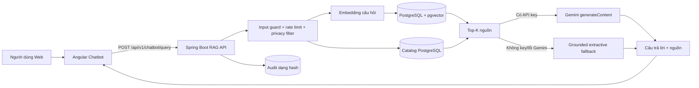

# TUẦN 12A — CHATBOT RAG QUA BACKEND VÀ GEMINI

## 1. Kết quả

Gói 12A đã thay Chatbot Web gọi mô hình trực tiếp bằng một pipeline RAG chạy qua Backend. Câu hỏi được kiểm tra, truy xuất nguồn liên quan từ PostgreSQL/pgvector và catalog, sau đó mới được chuyển cho Gemini. Phản hồi trả về luôn có danh sách nguồn; khi Gemini chưa được cấu hình hoặc gặp lỗi, hệ thống dùng câu trả lời trích xuất từ nguồn thay vì tự tạo quy định.

Trạng thái ngày 20/10/2026:

- Mã nguồn, migration, Web tích hợp và chế độ dự phòng cục bộ: hoàn thành.
- Gemini generation và embedding: đã triển khai và xác minh trực tuyến qua REST API; API key chỉ nằm trong `.env` cục bộ của Backend và được Git bỏ qua.
- Model đã chạy thực tế: `gemini-3.6-flash` cho generation và `gemini-embedding-2` cho embedding 768 chiều.
- Đánh giá định lượng Hit/Recall@K, groundedness và latency: thuộc gói 12B, chưa tính vào 12A.

## 2. Kiến trúc



Pipeline nạp dữ liệu khởi chạy cùng Backend:

1. Đọc các tệp Markdown có kiểm soát trong `backend/src/main/resources/rag/`.
2. Chuẩn hóa và chia đoạn có overlap.
3. Tạo embedding 768 chiều.
4. Lưu tài liệu, metadata nguồn, phiên bản, ngày hiệu lực, hash nội dung và chunk vào PostgreSQL.
5. Dùng chỉ mục HNSW cosine của pgvector để lấy top-K đoạn liên quan.

Khi có API key và `RAG_EMBEDDING_PROVIDER=auto`, hệ thống dùng `gemini-embedding-2`. Khi không có key, hệ thống dùng embedding hash cục bộ 768 chiều để vẫn có thể demo retrieval và fallback hoàn toàn offline. Đây là phương án dự phòng vận hành, không thay thế phần đánh giá chất lượng Gemini ở 12B.

## 3. Nguồn tri thức

| `source_key` | Nội dung | Phiên bản/ngày hiệu lực |
|---|---|---|
| `circulation-policy` | Mượn, trả, gia hạn, hàng đợi, khóa thẻ | `2026.10` / 18/10/2026 |
| `penalty-compensation-policy` | Quá hạn, mất/hỏng, đền bù, phí kỹ thuật | `2026.10` / 18/10/2026 |
| `payment-waiver-policy` | Thu tiền, điều chỉnh, miễn giảm | `2026.10` / 18/10/2026 |
| `library-service-guide` | QR thủ thư, tài liệu số, gợi ý sách và kênh hỗ trợ | `2026.10` / 18/10/2026 |

Catalog được truy xuất trực tiếp từ bảng sách khi câu hỏi có ý định tìm sách, tác giả, ISBN hoặc giáo trình. Nguồn catalog trả liên kết `/book/{bookId}`.

## 4. Dữ liệu và migration

Changeset `18-week12a-rag.yaml`:

- Bật extension `vector`.
- `rag_knowledge_documents`: metadata tài liệu, phiên bản, ngày hiệu lực và SHA-256.
- `rag_knowledge_chunks`: nội dung chunk, embedding `vector(768)`, provider và thứ tự chunk.
- Chỉ mục `idx_rag_chunks_embedding_hnsw` dùng `vector_cosine_ops`.
- `rag_query_audits`: request ID, actor/query hash, số nguồn, model, fallback, trạng thái và latency; không lưu nguyên văn câu hỏi.

Docker Compose dùng image `pgvector/pgvector:pg15` để Liquibase có thể tạo extension trên môi trường mới.

## 5. API

### Hỏi Chatbot

`POST /api/v1/chatbot/query` — cho phép cả khách và người dùng đã đăng nhập.

```json
{
  "message": "Tôi được gia hạn sách mấy lần?"
}
```

Phản hồi gồm `answer`, `sources`, `suggestions`, `grounded`, `fallbackUsed`, `model` và `requestId`.

### Quản trị chỉ mục

- `GET /api/v1/admin/rag/status`: xem số tài liệu, số chunk, provider và trạng thái cấu hình Gemini.
- `POST /api/v1/admin/rag/reindex`: dựng lại toàn bộ chỉ mục.

Hai API quản trị chỉ cho role `ADMIN`.

## 6. Cấu hình

Các biến cần thiết nằm trong `.env.example`:

```dotenv
PGVECTOR_IMAGE=pgvector/pgvector:pg15
GEMINI_API_KEY=
GEMINI_GENERATION_MODEL=gemini-3.6-flash
GEMINI_EMBEDDING_MODEL=gemini-embedding-2
RAG_EMBEDDING_PROVIDER=auto
RAG_TOP_K=5
RAG_MINIMUM_SCORE=0.60
RAG_GENERATION_THINKING_BUDGET=0
```

Không đưa API key vào `environment.ts` của Angular. Tên model là cấu hình môi trường để có thể đổi sang model được tài khoản Gemini cung cấp mà không sửa mã nguồn.

Khởi động và kiểm tra:

```powershell
docker compose up -d --build postgres backend
Invoke-RestMethod -Method Post `
  -Uri http://localhost:8080/api/v1/chatbot/query `
  -ContentType application/json `
  -Body '{"message":"Quy định gia hạn sách là gì?"}'
```

Sau khi thêm hoặc sửa nguồn Markdown, Admin gọi endpoint `reindex`. Nếu chỉ khởi động lại Backend, hệ thống chỉ lập chỉ mục lại tài liệu có hash/provider thay đổi.

## 7. An toàn và độ tin cậy

- Giới hạn 1.000 ký tự/câu hỏi và mặc định 10 request/phút/client.
- Từ chối các mẫu prompt injection phổ biến trước retrieval.
- System instruction yêu cầu chỉ dùng context được truy xuất và bỏ qua chỉ dẫn nằm trong tài liệu.
- Email, số điện thoại và MSSV được che trước khi câu hỏi rời Backend.
- Connect/read timeout mặc định 5/20 giây; lỗi Gemini chuyển sang fallback có nguồn.
- Thinking budget mặc định bằng 0 để tránh token suy luận chiếm hết giới hạn đầu ra của model Flash; phản hồi thiếu dẫn nguồn hoặc bị dừng vì `MAX_TOKENS` sẽ chuyển sang fallback.
- Ngưỡng cosine và top-K có thể cấu hình; nếu không có nguồn thì hệ thống từ chối trả lời thay vì bịa.
- Web render bằng Angular interpolation, không đưa câu trả lời mô hình vào `innerHTML`.
- Audit chỉ lưu SHA-256 của actor/câu hỏi cùng metadata vận hành.

## 8. Kết quả kiểm chứng 12A

- Backend: `111/111` test qua; có test migration pgvector bằng Testcontainers, cosine retrieval, fallback khi câu trả lời thiếu dẫn nguồn, input guard, privacy filter và authorization Admin.
- Web: `67/67` test qua; Chatbot service được kiểm tra chỉ gọi Backend, không gọi Google API trực tiếp.
- Angular production build thành công; còn cảnh báo CommonJS đã biết từ thư viện `qrcode`, không liên quan RAG.
- Docker/Gemini smoke: 4 tài liệu/7 chunk được lập chỉ mục bằng `gemini-embedding-2`; API trả `grounded=true`, `fallbackUsed=false`, model `gemini-3.6-flash` và 5 nguồn cho câu hỏi kiểm tra gia hạn.

## 9. Phần đánh giá đã chuyển sang 12B

- Bộ 14 câu chuẩn và các chỉ số Hit/Recall@5, nguồn đúng, nội dung bám nguồn, citation, từ chối đúng cùng p50/p95 đã hoàn thành trong [`TUAN_12B_DANH_GIA_CHATBOT_RAG.md`](TUAN_12B_DANH_GIA_CHATBOT_RAG.md).
- Kết quả máy đọc được nằm tại [`rag_evaluation_2026-10-20.json`](rag_evaluation_2026-10-20.json).
- Embedding hash offline chỉ phục vụ khả năng demo khi mất mạng; không được dùng để kết luận chất lượng semantic của mô hình Gemini.
- Rate limit hiện lưu trong bộ nhớ từng instance; nếu triển khai nhiều Backend instance thì nên chuyển bộ đếm sang Redis.
